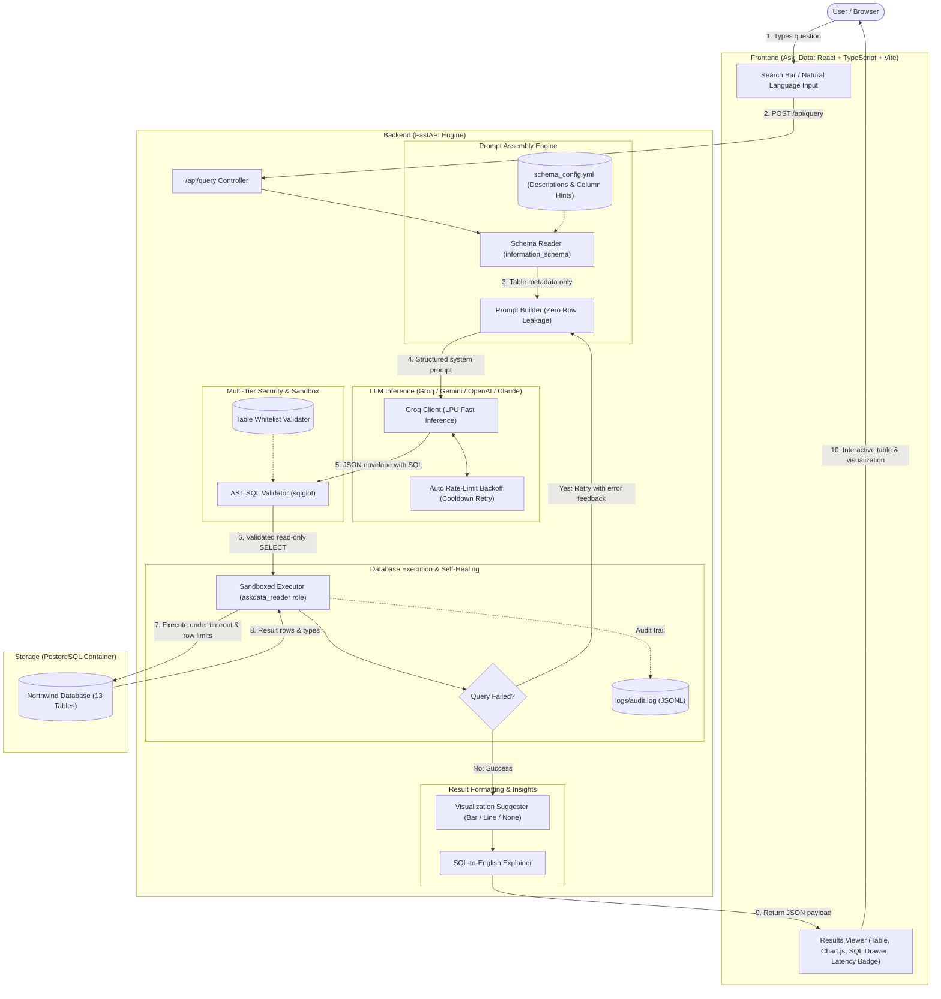
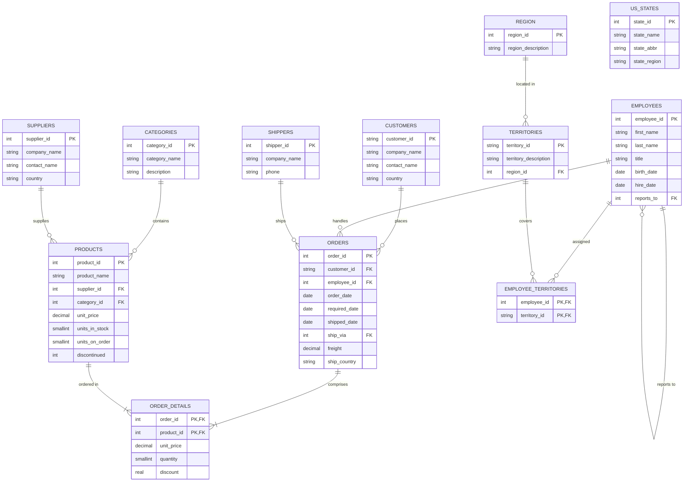

# AskData — Natural-Language Data Assistant

AskData allows non-technical teams to ask questions about a PostgreSQL database in plain English and receive instant, verified answers: interactive charts, data tables, the generated SQL query, and a step-by-step plain-English explanation.

---

## Architecture & Data Flow Diagram (DFD)

The diagram below details the data flow from the user's natural-language query through schema metadata assembly, LLM inference, AST security validation, sandboxed database execution, self-healing recovery, and UI visualization:



---

## Entity-Relationship (ER) Diagram

AskData is pre-configured with the **Northwind** relational dataset running on PostgreSQL. The database schema and its foreign-key relationships are modeled below:



---

## Key Features & Security Guarantees

1. **Zero Row Data Leakage**:
   - Only table definitions, column types, and foreign keys from `information_schema` are sent to the LLM. Your actual customer, financial, and order records never leave your infrastructure.
2. **Deterministic AST Validation**:
   - Every generated SQL string is parsed into an Abstract Syntax Tree (AST) using `sqlglot`.
   - Multi-statement queries, comments, and any non-`SELECT` operations (`INSERT`, `UPDATE`, `DELETE`, `DROP`, `ALTER`, `TRUNCATE`, `COPY`, `GRANT`) are blocked before database execution.
3. **Database-Level Isolation**:
   - The query executor connects using an unprivileged PostgreSQL role (`askdata_reader`) restricted to read-only transactions (`SET TRANSACTION READ ONLY`).
4. **Guaranteed Execution Bounds**:
   - Every query runs with a strict PostgreSQL `statement_timeout` (default 10s) and is automatically capped at 1,000 rows (`LIMIT 1000`) to prevent denial-of-service or memory spikes.
5. **Self-Healing SQL Loop**:
   - If PostgreSQL reports a syntax error, unknown function, or type mismatch, the system feeds the failed query and error message back to the LLM for a one-shot automatic repair.
6. **Graceful Ambiguity Clarification**:
   - When a natural-language request lacks direction (e.g. *"Show 5 products by price"* without specifying highest or lowest), the model requests clarification rather than making assumptions.
7. **Production Audit Trail**:
   - Every query, validation result, latency metric, and error is recorded in `logs/audit.log` (JSON Lines format) for compliance and monitoring.

---

## Quick-Start Guide

### Prerequisites
- **Docker Desktop** (for containerized PostgreSQL)
- **Python 3.11+**
- **Node.js 18+**

### 1. Launch the Database
```bash
docker compose up -d
```
*Initializes PostgreSQL on port 5432 with the Northwind dataset and configures the `askdata_reader` read-only role.*

### 2. Configure Environment Variables
Copy `backend/.env.example` to `backend/.env`:
```powershell
Copy-Item backend\.env.example backend\.env
```

Edit `backend/.env` with your settings:
```dotenv
# Database Admin & Reader Credentials
DB_HOST=localhost
DB_PORT=5432
DB_NAME=northwind
DB_USER=postgres
DB_PASSWORD=postgres
DB_READONLY_USER=askdata_reader
DB_READONLY_PASSWORD=askdata_readonly_pw

# LLM Provider Configuration
LLM_PROVIDER=groq
LLM_MODEL=qwen/qwen3.8-27b
GROQ_API_KEY=your_groq_api_key_here

# Safety Limits
QUERY_TIMEOUT_SECONDS=10
QUERY_ROW_LIMIT=1000
```

### 3. Start the Backend API
```powershell
cd backend
python -m venv .venv
.\.venv\Scripts\Activate.ps1
pip install -r requirements.txt
uvicorn app.main:app --reload --port 8000
```
Verify the backend at: `http://localhost:8000/health`

### 4. Start the Frontend
```powershell
cd Ask_Data
npm install
npm run dev
```
Open **`http://localhost:5173`** in your browser.

---

## LLM Provider Support

AskData supports multiple AI model providers via direct API integration:

| Provider | `LLM_PROVIDER` | Recommended Model | Notes |
| :--- | :--- | :--- | :--- |
| **Groq (Default)** | `groq` | `qwen/qwen3.8-27b` or `openai/gpt-oss-20b` | Ultra-fast LPU inference (~0.7s to 1.1s) with automatic rate-limit cooldown handling. |
| **Google Gemini** | `google` | `gemini-3.8-flash` | Requires API key from Google AI Studio. |
| **OpenAI** | `openai` | `gpt-4o-mini` | Requires OpenAI API key. |
| **Anthropic** | `anthropic` | `claude-3-haiku-20240307` | Requires Anthropic API key. |

---

## Testing & Quality Assurance

### Run the Backend Test Suite (51 Unit & Integration Tests)
```powershell
cd backend
.\.venv\Scripts\pytest -o pythonpath=.
```
Tests cover:
- API endpoints & status codes (`tests/test_api.py`)
- AST SQL validation and attack vectors (`tests/test_sql_validator.py`)
- Read-only transaction enforcement (`tests/test_sql_executor.py`)
- Prompt generation & few-shot consistency (`tests/test_sql_generator.py`)
- Groq client and rate-limit recovery (`tests/test_groq_client.py`)
- Benchmark comparison logic (`tests/test_benchmark.py`)

### Run the 30-Question Accuracy Benchmark
```powershell
cd backend
.\.venv\Scripts\python -m benchmarks.run_benchmark
```
Evaluates the model across 30 reference questions spanning single-table aggregations, multi-table joins, subqueries, and window functions. Detailed results and latency percentiles are saved to `backend/benchmarks/results/`.

---

## API Reference

### `POST /api/query`
Generates, validates, and executes a natural-language query.

**Request Body:**
```json
{
  "question": "Top 5 products with highest unit price"
}
```

**Response Body:**
```json
{
  "status": "success",
  "question": "Top 5 products with highest unit price",
  "sql": "SELECT product_name, unit_price FROM products ORDER BY unit_price DESC LIMIT 5",
  "columns": ["product_name", "unit_price"],
  "rows": [
    {"product_name": "Côte de Blaye", "unit_price": 263.5},
    {"product_name": "Thüringer Rostbratwurst", "unit_price": 123.79},
    {"product_name": "Mishi Kobe Niku", "unit_price": 97.0},
    {"product_name": "Sir Rodney's Marmalade", "unit_price": 81.0},
    {"product_name": "Carnarvon Tigers", "unit_price": 62.5}
  ],
  "row_count": 5,
  "chart": {
    "type": "bar",
    "x_axis": "product_name",
    "y_axis": "unit_price"
  },
  "explanation": "Reads from products. Sorts the results using ORDER BY. Caps the returned rows with LIMIT.",
  "message": null,
  "retry_count": 0,
  "latency_seconds": 1.05
}
```

**Status Values:**
- `success`: Query generated, validated, and executed successfully.
- `clarification`: Question was ambiguous; `message` contains the clarification question.
- `blocked`: Query was blocked by the safety validator (e.g. non-SELECT, disallowed table).
- `error`: Query preparation or execution failed after retry.

---

## Project Directory Structure

```
AskData/
├── docker-compose.yml              # PostgreSQL container configuration
├── README.md                       # Documentation, ER & DFD diagrams
├── database/
│   └── init/
│       ├── 01_northwind.sql        # Northwind database schema and sample data
│       └── 02_readonly_role.sql    # Unprivileged askdata_reader user creation
├── backend/
│   ├── .env.example                # Sample environment variables
│   ├── schema_config.yml           # Human-readable column & table descriptions
│   ├── requirements.txt            # Python dependencies
│   ├── app/
│   │   ├── main.py                 # FastAPI application entry point & CORS
│   │   ├── api/
│   │   │   └── routes.py           # /api/query and /health endpoints
│   │   └── core/
│   │       ├── config.py           # Pydantic settings loading from .env
│   │       ├── llm_client.py       # Multi-provider LLM client with Groq backoff
│   │       ├── schema_reader.py    # Database catalog and metadata inspection
│   │       ├── sql_generator.py    # Prompt builder and response envelope parser
│   │       ├── sql_validator.py    # sqlglot AST security validator
│   │       └── sql_executor.py     # Read-only psycopg2 transaction runner
│   ├── benchmarks/
│   │   ├── questions.json          # 30 golden reference benchmark questions
│   │   ├── run_benchmark.py        # Benchmark harness & accuracy evaluator
│   │   └── results/                # Timestamped benchmark run logs
│   └── tests/                      # Pytest test suite (51 tests)
├── logs/
│   └── audit.log                   # Production JSONL audit trail
└── Ask_Data/                       # React + TypeScript + Vite frontend
    ├── package.json
    ├── vite.config.ts
    └── src/
        ├── App.tsx                 # Core UI with query input, table & chart views
        ├── App.css                 # Custom styling
        └── main.tsx
```

---

## License

This project is licensed under the MIT License.
